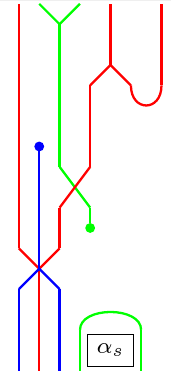
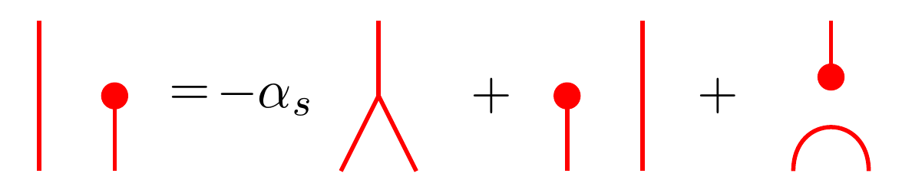

# General Information

A Sage package for working with morphisms in the algebraic/diagrammatic Hecke category and calculating expansions of morphisms in terms of the double leaf basis. 

## Overview

`DLCalc` is a package for performing calculations in the category of Abe--Bott--Samelson bimodules or, equivalent, the Elias--Williamson diagrammatic Hecke category. A user of this package should be familiar with the diagrammatic Hecke category and the general theory of Coxeter groups and Hecke algebras. One also benefits from having some familiarity with the theory of double leaves [Lib08, EW16, Abe19] and the localized calculus of [EW23, Abe21].  

## Installation

Use an existing `SageMath` installation. The release was tested with **Sage 10.9 and Python 3.12.14**. A recent Sage installation is required; ordinary Python alone does not supply the mathematical dependencies.

No installation is required to use the files. Simply navigate to the directory containing the source code, open a python interpreter, and import the necessary files.

```bash
cd DLCalc
python3
```

```python
from formats import *
from quadratic import *
from coxeter import *
from morphisms import *
from leaves import *
from reconstruct import *
from verify import *
```

Alternatively, oen can create any python script and refer to these files as normal.

## Running Tests

A sizeable collection of unit tests are included in this package and test most of the functionality to some degree. To run these simply execute.

```bash
cd DLCalc
python3 -m unittest -v tests
```

## Included Files

Here is a brief overview of the included files.

- `formats.py` - some helper functions for working with JSON files and handling errors
- `quadratic.py` - some helper functions for doing arithmetic in $\mathbb{Q}$ or $\mathbb{Q} (\phi)$.
- `coxeter.py` - all the basic structures needed for working with Coxeter groups and realizations of them. The Coxeter groups themselves are implemented using `SageMath` and the class `CoxeterSystem` is a combination of a Coxeter group and a realization. Also includes all the necessary structures for working with subexpressions, defects, deterministic reduced expressions, and deterministic reduced paths that are not covered by `SageMath`'s existing Coxeter packages.
- `morphisms.py` - contains to fundamental classes `Morphism` and `Localization`. The class `Morphism` is used for any morphism between Abe--Bott--Samelson bimodules. Many different ways to construct such morphisms are implemented. The class `Localization` is for computing localization entries and matrices of morphisms. Crucially, `Localization` also allows for specialization at a fixed point which is used in the interpolation algorithms.
- `leaves.py` - Construction of light leaves and double leaves efficiently. Also special handling of localization entries for double leaves using the "weighted dot product" formula of the companion paper. A class is included for handling the double leaves basis called `DoubleLeavesBasis`. Most importantly, this class allows one to evaluate the $\lambda$ functionals on morphisms.
- `reconstruct.py` - The scripts to find the expansion of a given morphism in a double leaf basis. A slight modification of `Morphism` is included in this class called `Expansion`. This class contains extra metadata on the process in which expansions are found.
- `verify.py` - The scripts to determine whether two morphisms are equal. There are three implemented algorithms: using localization matrices, using $\lambda$ functionals symbolically, and using $\lambda$ functionals via interpolation.
- `tests.py` - A collection of unit tests to ensure that the package is working correctly.
- `data/` - A collection of pre-made morphisms for ease of use. Includes the morphisms appearing the Zamoldchikov relation in $H_3$ as well as its double leaf expansion. 
Also includes various other examples that appear in this file.

## AI Usage

Some of the code in this package was generated using OpenAI's Codex software.
Initially, the entire codebase was generated by AI; however, I felt that this had some major problems.

1. Ultimately, I am responsible for the code. To ensure the code is accurate, I decided that the vast majority of the code should be rewritten in the author's own style.
2. The initial code produced by Codex was far more restrictive and not very usable by other mathematicians. Moreover, it is very hard to get generative AI to correctly document code especially for use by mathematicians and not programmers.

Nonetheless, there are still residuals of generated code in this package. Notably, the unit tests in `tests.py` are almost entirely AI generated. However, I have went through each test carefully. Ultimately, I felt that additional tests can only benefit the validity of the package rather than hinder it. These tests are far from comprehensive, and again, I maintain responsibility for the whole project. 
The file for rendering morphisms `render.py` as LaTeX documents is also largely AI generated (probably about 30% of it is my own code). This was decided since it is a means of presenting data, but the presentation does not affect the validity of the computed results.

The vast majority of the rest of the code was written (or rewritten) by myself. In particular, if you are dissatisfied with the naming of variables, documentation, performance of the code, or general layout---well you can put the blame solely on good ol' fashion human imperfection. I am certainly open to any comments or suggestions on how to improve the package. 

# Coxeter Systems with Realizations

The file `coxeter.py` has a class `CoxeterSystem` which incorporates both Coxeter groups and realizations.
We always assume that our realizations arise via a Cartan matrix.

## Defaults

There are a handful default Coxeter systems implemented. First, is the Coxeter group of type $A_3$ with simple reflections $s,t,u$ satisfying $m_{st} = 3$, $m_{tu} =3$, and $m_{su} = 2$. The ambient realization is the geometric realization $\mathfrak{h} = \mathbb{Q} \alpha_s^{\vee} \oplus \mathbb{Q} \alpha_t^{\vee} \oplus \mathbb{Q} \alpha_u^{\vee}$  with Cartan matrix
$$ \begin{bmatrix} 2 & -1 & 0 \\ -1 & 2 & -1 \\ 0 & -1 & 2 \end{bmatrix}.$$
This can be constructed as follows:
```python
from coxeter import *
W = CoxeterSystem("A3")
```
Next, is the Coxeter group of type $B_3$ with simple reflections $s,t,u$ satisfying $m_{st} = 4$, $m_{tu} = 3$, and $m_{su} = 2$.
The ambient realization is the Cartan realization (i.e., corresponding to an adjoint group of type $B_3$) over $\mathbb{Q}$ with Cartan matrix
$$ \begin{bmatrix} 2 & -2 & 0 \\ -1 & 2 & -1 \\ 0 & -1 & 2 \end{bmatrix}.$$
This can be constructed as follows:
```python
from coxeter import *
W = CoxeterSystem("B3")
```
Next, is the Coxeter group of type $H_3$ with simple reflections $s,t,u$ satisfying $m_{st} = 5$, $m_{tu} = 3$, and $m_{su} = 2$.
The ambient realization is the *golden realization*. First, consider the ring $\mathbb{Q} (\phi)$ where $\phi = (1 + \sqrt{5})/2$ is the golden ratio.
Then the realization is given by $\mathfrak{h} = \mathbb{Q} \alpha_s^{\vee} \oplus \mathbb{Q} \alpha_t^{\vee} \oplus \mathbb{Q} \alpha_u^{\vee}$  with Cartan matrix
$$ \begin{bmatrix} 2 & -\phi & 0 \\ -phi & 2 & -1 \\ 0 & -1 & 2 \end{bmatrix}.$$
This can be constructed as follows:
```python
from coxeter import *
W = CoxeterSystem("H3")
```
Finally, there is also a pre-made implementation of the Coxeter groups of type $I_2 (m) \times A_1$ with simple reflections $s,t,u$ satisfying $m_{st} = m$, $m_{tu} = 2$, and $m_{su} = 2$.
The ambient realization has Cartan matrix
$$ \begin{bmatrix} 2 & x & 0 \\ y & 2 & 0 \\ 0 & 0 & 2 \end{bmatrix},$$
where
$$x = \begin{cases} 0 & m=2, \\ -1 & m=3, \\ -2 & m=4, \\ -\phi & m=5, \\ -3 & m=6, \\ -2 \zeta^{2m} & m > 6 \end{cases} \qquad\text{and}\qquad y =  \begin{cases} 0 & m=2, \\ -1 & m=3, \\ -1 & m=4, \\ -\phi & m=5, \\ -1 & m=6, \\ -2  \zeta^{2m} & m > 6 \end{cases}$$
where $\phi$ is defined as in the $H_3$ case and $\zeta^{2m}$ is a primtiive $2m$-th root of unity. This realization is defined over $\mathbb{Q}$ when $m=2,3,4, 6$, $\mathbb{Q} (\phi)$ when $m=5$, and the ring of real algebraic numbers $\mathbb{A}$ when $m > 6$. This can be constructed as follows:
```python
from coxeter import *
m = 4 # Or any other value of m
W = CoxeterSystem.dihedral_product(m)
```

## Other methods for constructing Coxeter systems

We can also construct associated to an arbitrary Coxeter group with the realization whose Cartan matrix $A = (a_{st})$ is given by
$$ a_{st} = \begin{cases} 0 & m_{st}=2, \\ -1 & m_{st}=3, \\ -\phi & m_{st} = 5, \\ -2 & m_{st} = \infty \\ -2\zeta^{2m_{st}} & \text{otherwise} \end{cases} $$
These can be constructed in the code by supplying either a square Coxeter matrix, a Sage Cartan type, or an existing Sage Coxeter group. For example, if $W$ is of type $F_4$, these all give essentially equivalent constructions.
```python
from sage.all import CoxeterGroup
from coxeter import *

CoxeterSystem("F4")

G = CoxeterGroup("F4")
CoxeterSystem(G)

C = [
    [1, 3, 2, 2],
    [3, 1, 4, 2],
    [2, 4, 1, 3],
    [2, 2, 3, 1]
] # The Coxeter matrix of F4
CoxeterSystem(C)
```

Finally, we can also supply our own Cartan matrix and ground field.
The only ground fields supported are $\mathbb{Q}, \mathbb{Q} (\phi)$, and $\mathbb{A}$. 
```python
from sage.all import QQ
from coxeter import *

A = [
    [ 2, -1,  0,  0],
    [-1,  2, -1, -1],
    [ 0, -1,  2,  0],
    [ 0, -1,  0,  2]
] # Cartan matrix for the Cartan realization of type D4

W = CoxeterSystem("D4", cartan=A, field=QQ)
```

## Expressions

The `CoxeterSystem` class has some functions for handling expressions and reduced expressions in a more deterministic manner than the native `SageMath` implementation.
By default, expressions are stored as tuples of strings where each string is the label of a simple reflection.
```python
from coxeter import *
W = CoxeterSystem("A3")
W.word('stsut') 
```
```text
('s', 't', 's', 'u', 't')
```
Given an expression, we can also find the corresponding element of `W.group`,
```python
W.element('stsut')
```
```text
[ 0  0 -1]
[ 0 -1  0]
[ 1 -1  0]
```

The key departure from `SageMath` is in our fixed choice of reduced expressions and paths between reduced expressions in the rex graph.
The specified algorithm can be found in the companion paper.
```python
w = W.element('tstutt')
W.reduced_word(w)
```
```text
('s', 't', 's', 'u')
```
A rex path will be given by a tuple whose entries are pairs `(i, m)` where `i` is the position of the rex move and `m` is the length of the braid. 
For example,
```python
W.rex_path('stusts', 'utustu')
```
```text
((2, 2), (0, 3), (2, 3), (1, 2), (4, 2), (2, 3), (0, 3))
```
This corresponds to the path
$$ stusts \mapsto stsuts \mapsto tstuts \mapsto tsutus \mapsto tustus \mapsto tustsu \mapsto tutstu \mapsto utustu.$$

## Subexpressions

There is a separate `Subexpression` class found in `coxeter.py`. This is a dataclass. To explain the attributes suppose that $\underline{w} = (s_1, \ldots, s_k)$ is an expression with a subexpression $\mathbf{e} = (e_1, \ldots, e_k)$. Then the attributes for the corresponding `Subexpression` class are as follows.
 - `mask` - the actual subexpression $\mathbf{e} = (e_1, \ldots, e_k)$ encoded as an integer using the formula,
 $$ \sum_{i=1}^k e_i 2^{i-1},$$
 - `endpoint` - the element in the Coxeter group given by $\underline{w}^{\mathbf{e}} = s_1^{e_1} \ldots s_k^{e_k}$,
 - `defect` - the defect of the subexpression, i.e., the number of $U0$ decorations minus the number of $D0$ decorations
 - `bruhat_stroll` - a tuple describing the Bruhat stroll for $\mathbf{e}$, i.e.,
 $$ (s_1^{e_1}, s_1^{e_1} s_2^{e_2}, \ldots, s_1^{e_1} \ldots s_k^{e_k} ),$$
 - `decorations` - a tuple of strings describing the decorations of the Bruhat stroll

 To construct a Subexpression, one must use the `subexpression` function for `CoxeterSystem`. For example,
 ```python
from coxeter import *
W = CoxeterSystem("A3")
W.subexpression('sts', 5)
 ```
 ```text
Subexpression(
    endpoint = [ 1 0 0 ]
                [ 0 1 0 ]
                [ 0 0 1 ],
    defect = 1,
    bruhat_stroll = (
        [ -1 1 0 ]   [ -1 1 0 ]   [ 1 0 0 ]
        [  0 1 0 ]   [  0 1 0 ]   [ 0 1 0 ]
        [  0 0 1 ],  [  0 0 1 ],  [ 0 0 1 ]
    )
    decoration = ('U1', 'U0', 'D1')
)
 ```

 To make it easier to convert between masks and tuples of 0's and 1's, there are also two convenient functions implemented. For example, to take a tuple and produce a mask, we can use the following,
 ```python
subexpression_to_mask((1,1,0,0,1))
 ```
 ```text
 (19, 5)
 ```
 The first number is the actual mask, and the last number is the length of the subexpression. To go the other direction,
 ```python
mask_to_subexpression(19,5)
```
```text
(1, 1, 0, 0, 1)
```

We can also find the tuple of all subexpressions by calling the `subexpressions` function. For example,
```python
W.subexpression("stst")
```

## Defect Hom Formula

The last primary function of the `CoxeterSystem` class is to find the dimensions of the homogeneous Hom space, $\textnormal{Hom}^d (B_{\underline{x}}, B_{\underline{y}})$.
For example,
```python
source = "stusts" 
target = "tsusts" 
degree = 2 
W.hom_profile(source, target, degree)
```
```json
{
    'degree': 2, 
    'dimension': 86, 
    'candidates': 57, 
    'basis_degrees': {
        -2: 1, 
        0: 12, 
        2: 44
    }
}
```
The candidates refers to the number of the double leaves that contribute to the Hom space. The basis degrees encode the degree of these double leaves.
In this example, $\dim R^2 = 3$ and $\dim R^4 = 6$, so
$$\dim \textnormal{Hom}^2 (B_{stusts}, B_{tsusts}) = 86 = 44 + 12 \cdot 3 + 1 \cdot 6.$$

# Morphisms

The implementation of morphisms between Abe--Bott--Samelson bimodules is provided by the `Morphisms` class found in `morphisms.py`.
There are very little computations done in this class. In particular, we don't perform any diagrammatic simplifications. The class is really just a convenient 
way to encode the data, perform basic operations like tensors, and to ensure that every morphism is at least well-defined.

For this section, we will work with the following starting code.
```python
from coxeter import *
from morphisms import *
W = CoxeterSystem("A3")
```

## Generating Morphisms

For the generating morphisms, there are some handy implemented class methods for constructing them.

We can start with identity morphisms,
```python
Morphism.identity(W, "sts")
```
This corresponds to the identity morphism $B_{sts} \to B_{sts}$.

We can also consider a morphism where we insert a polynomial box into one of the regions of the identity morphism (counted from the left),
```python
R = system.ring
alpha_s = R('alpha_0')
Morphism.box(W, "sts", alpha_s, 1)
```
This is the morphism $\textnormal{id}_{B_s} \otimes \alpha_s \textnormal{id}_{B_{ts}} : B_{sts} \to B_{sts}$.

There is also the zero morphism which can take an arbitrary source and target
```python
Morphism.zero(W, "sts", "t")
```
This corresponds to the zero morphism $B_{sts} \to B_{t}$.

Next, we can consider the upper dot and lower dot morphisms,
```python
Morphism.upper_dot(W, "s")
Morphism.lower_dot(W, "s")
```
that correspond to the counit and unit maps $B_s \to R$ and $R \to B_s$.

Likewise, there are the merge and split morphisms,
```python
Morphism.merge(W, "s")
Morphism.split(W, "s")
```
that correspond to the multiplication and comultiplication maps $B_{ss} \to B_s$ and $B_s \to B_{ss}$.

Next, there are the cap and cup morphisms,
```python
Morphism.cap(W, "s")
Morphism.cup(W, "s")
```
that correspond to the compositions of merge with counit and unit with split, $B_{ss} \to R$ and $R \to B_{ss}$.

Lastly, there is the braid morphisms,
```python
Morphism.braid(W, "s", "t")
```
that corresponds to the $2m$-valent vertex $B_{st\ldots} \to B_{ts\ldots}$. This morphism requires $m = m_{s,t} < \infty$.

## From Elias-Williamson graphs

The other way of constructing morphisms is by encoding an Elias--Williamson graph.
The basic idea is that we can write any Elias--Williamson graph as a composition of morphisms which are generators tensored with identity maps.
The notion of a generator tensored with identity maps is encoded in the `Operation` class found in `morphisms.py`. This is a data class with a handful of attributes,
 - `kind` - the type of generator appearing. This can be one of the following options "polynomial", "upper dot", "lower dot", "merge", "split", "cup", "cap", or "braid". 
 - `position` - where the generator is inserted amongst the identity morphisms
 - `color` - the simple reflection associated to the generator. This is inferred from the source of the morphism unless the `kind` is either "lower dot" or "cup". For other operations, this is set to `None`.
 - `length` - this is equal to $m_{st}$ when the `kind` is "braid". For other operations, `length` is set to `None`. 
 - `polynomial` - the polynomial appearing when `kind` is "polynomial". For other operations, `polynomial` is set to `None`
Here are some examples,

```python
R = W.ring
alpha_s = R("alpha_0")
Operation(kind="polynomial", position=0, polynomial=alpha_s)

Operation(kind="merge", position=1)

Operation(kind="cup", position=2, color="s")

Operation(kind="braid", position=0, length=3)
```

An operation does not actually store the source or target of the corresponding morphism. This will be inferred from the class method `elias_williamson_graph` when constructing a morphism. To see how one can do this, it is best to give an example. First consider the following Elias--Williamson graph,



The morphism can be constructed as follows,
```python
R = W.ring
alpha_s = R("alpha_0")
operations = [
    Operation("polynomial", position=4, polynomial=alpha_s),
    Operation("cap", position=3),
    Operation("braid", position=0, length=3),
    Operation("lower dot", position=3, color="u"),
    Operation("braid", position=2, length=2),
    Operation("upper dot", position=1),
    Operation("cup", position=3, color="s"),
    Operation("merge", position=2),
    Operation("split", position=1)
]

Morphism.elias_williamson_graph(W, "tstuu", operations)
```

## Saving/Loading Morphisms

There are two convenient functions for saving and loading morphisms from files. For example, if `morphism` is an instance of `Morphism`, then we can save it to the path `data/morphism.json` by

```python
morphism.save("data/morphism.json")
```

The JSON structure is pretty straightforward and a handful of examples are included in the `data/` folder.

The process for loading a morphism is similarly easy. For example, if we want to load the morphism we just saved, we can do as follows.

```python
morphism = Morphism.load("data/morphism.json")
```

## Morphism manipulations

There are a handful of manipulations of morphisms that are implemented in the `Morphism` class:
- Sums
- Scaling
- Composition
- Tensors
- Duals

For example, if `f` and `g` are morphism objects, then we can take their sum as one might expect
```python
f+g
```
Likewise, scaling can be done using `*`,
```python
R = W.ring
alpha_s = R("alpha_0")
alpha_s * f
```
Compositions can be done with either `@` or `.then`,
```python
f @ g
f.then(g)
```
The order is slightly non-standard here. In particular, both `f @ g` and `f.then(g)` are implementation of the composition $g \circ f$.

Tensors can be accomplished using `.tensor`,
```python
f.tensor(g)
```
which should be interpreted as $f \otimes g$.

Finally, a horizontal reflection of a diagram, which we call the dual, can be done by using `.dual`,
```python
f.dual()
```

## Homogeneous Components

The `Morphism` class takes into consideration graded degrees for morphisms.
The property `.homogeneous_components` can be used to find the homogeneous components of a given morphism. This will return a read-only mapping from degrees to homogeneous morphisms of that degree. For example,
```python
f = Morphism.identity(W,"s") + Morphism.upper_dot(W,"s").then(Morphism.lower_dot(W,"s"))
dict(f.homogeneous_components)
```
```python
{
    0 : Morphism.identity(W,"s"),
    2 : Morphism.upper_dot(W,"s").then(Morphism.lower_dot(W,"s"))
}
```
We note that since no simplifications of morphisms happens in the `Morphism` class, these degrees are not necessarily real.
For example, the degree of `f-f` is the same as the degree of `f` rather than $0$.

If a morphism is homogeneous, the property `.degree` records the degree. If the morphism is not homogeneous, then `.degree` returns `None`.
```python
f = Morphism.upper_dot(W,"s").then(Morphism.lower_dot(W,"s"))
f.degree
```
```
2
```

# Localization

The `morphisms.py` file also has a class `Localization` for calculating entries and columns of the localization matrix of a morphism. There are two fundamental types of the `Localization` class.
- Symbolic - this is the most natural version of the class. Here all computations happen in the fraction field of $R$ and make use of airthmetic in Sage.
- Pointwise - After identifying $R = \mathbb{k} [x_1, \ldots, x_r]$, we can perform computations after the evaluation at a point $a \in \mathbb{k}^r$. Some caution is needed in specifying the point; otherwise, 
there might be division by 0 errors. To resolve this, one should always chose the point $a$ to be *regular* in the sense of the companion paper. The key advantage of this approach is that it is much faster to perform arithmetic in $\mathbb{k}$ instead of $\textnormal{Frac} (R)$.

To initialize a symbolic localization evaluator, we simply need to pass the Coxeter system to `Localization`.

```python
from coxeter import *
from morphisms import *
W = CoxeterSystem("A3")
loc = Localization(W)
```

To initalize a pointwise localization evaluator, we need to additionally specifying a point.

```python
from coxeter import *
from morphisms import *
W = CoxeterSystem("A3")
point = (1,1,1)
loc = Localization(W, point=point)
```

In the above case, we will set $\alpha_s, \alpha_t$, and $\alpha_u$ to $1$ in our localization calculations.

Most of the calculations in `Localization` are built on finding the columns of a localization matrix. To do this, we use the function `.column` which takes two parameters, the morphism, and the column.
The columns of the localization matrix are indexed by subexpressions of the source. We will use integer masks when passing these to parameters of `.column`

```python
loc = Localization(W)
f = Morphism.identity(W,"s").tensor(Morphism.cup(W,"s")) # Morphism from B_s -> B_{sss}
print(loc.column(f,0))
print(loc.column(f,1))
```
```text
{0: 1/alpha_0, 6: (-1)/alpha_0}
{1: 1/(-alpha_0), 7: (-1)/(-alpha_0)}
```

If we instead wanted to evaluate this column at $(1,1,1)$, we would instead compute, 
```python
point = (1,1,1)
loc = Localization(W, point=point)
f = Morphism.identity(W,"s").tensor(Morphism.cup(W,"s")) # Morphism from B_s -> B_{sss}
print(loc.column(f,0))
print(loc.column(f,1))
```
```text
{0: 1, 6: -1}
{1: -1, 7: 1}
```

One can observe that the return values of `.column` are always a dictionary rather than a tuple of the entries. 
In practice, localization matrices are quite sparse, so it is advantageous to only list the nonzero entries.

If we want to find a specific localization entry, we can use `.entry`. This function takes 3 parameters: the morphism, the target subexpression mask, and the source subexpression mask.
```python
loc = Localization(W)
f = Morphism.identity(W,"s").tensor(Morphism.cup(W,"s")) # Morphism from B_s -> B_{sss}
loc.entry(f,7,1)
```
```text
(-1)/(-alpha_0)
```

We can also find the whole localization matrix using `.localization_matrix`. This function should only be used when the morphism is relatively small since it gets quite hard to compute as the source and target expressions grow in size.
```python
loc = Localization(W)
f = Morphism.identity(W,"s").tensor(Morphism.cup(W,"s")) # Morphism from B_s -> B_{sss}
dict(loc.localization_matrix(f))
```
```json
{
    (0, 0): 1/alpha_0, 
    (6, 0): (-1)/alpha_0, 
    (1, 1): 1/(-alpha_0), 
    (7, 1): (-1)/(-alpha_0)
}
```

The general method for finding localization data can be found in [EW23] or the companion paper. 
The overall strategy is to split things up into 

# Double Leaves

We handle double leaves differently than general morphisms. The file `leaves.py` includes the necessary code for working with light leaves, double leaves, and the double leaf basis.
For the sake of streamlining the examples in this section, we will use the following setup.

```python
from coxeter import *
from morphisms import *
from leaves import *

W = CoxeterSystem("A3")
```

## Light Leaves

The method for constructing a light leaf can be found in `leaves.py` under the function `light_leaf`. For example, the light leaf with domain $B_{stsstt}$ and subexpression $\mathbf{e} = (0,0,1,1,0,0)$, the light leaf $LL_{stsstt, \mathbf{e}}$ can be constructed as follows,

```python
mask, length = subexpression_to_mask((0,0,1,1,0,0)) # (12, 6)
light_leaf(W, "stsstt", mask)
```

This is an instance of the `Morphism` class, and more precisely, we store the light leaf as an Elias-Williamson graph.

Double leaves are stored differently than light leaves. This is primarily due to the fact that we can find entries of the localization matrix for a double leaf from its constituent light leaves.
We can construct one as follows:

```python
source = "stsstt"
target = "tstt"
source_mask, _ = subexpression_to_mask((1,1,1,0,1,1)) # (55, 6)
target_mask, _ = subexpression_to_mask((1,1,1,0)) # (7, 4)
double_leaf(W, source, target, source_mask, target_mask)
```

This give us the double leaf $\mathbb{L}\mathbb{L}_{111011,1110} : B_{stsstt} \to B_{tstt}$ which has degree $-2$. The underyling Elias-Williamson graph is not stored in this instance of `Morphism`.
Instead, only the source and target subexpressions are recorded. If we wish to expand it to an Elias-Williamson graph, we can use
```python
DL = double_leaf(W, source, target, source_mask, target_mask)
expand_double_leaf(DL)
```

We compute the entries of the localization matrix for double leaves using the "weight dot product" formula that can be found in Proposition 3.8 of the companion paper. This means that we only
compute columns of the localization matrices for the constituent light leaves. This is much faster in practice since many double leaves have overlapping light leaf constituents and we can cache the columns computed for light leaves.

The following example computes the $(1000, 01000)$-entry of the localization matrix for $\mathbb{L}\mathbb{L}_{111011, 1110}$.

```python
id = W.element("e")
loc = Localization(W)
double_leaf_entry(
    loc, # instance of a Localization class
    "stsstt", # source of double leaf
    "tstt", # target of double leaf
    55, # source subexpression for double leaf, 111011
    7, # target subexpression for double leaf, 1110
    1, # row subexpression, 1000
    2, # column subexpression, 01000
    prefix=id
)
```
```text
alpha_0^2/alpha_1^2
```

The last parameter is a prefix by an element of $W$. More generally, the above method can be used to compute the localization entry after applying an element $w$.

## Double Leaf Basis

If we want to find all double leaves that could possibly contribute to a homogeneous morphism, we can use the class `DoubleLeavesBasis`. The constructor for the class takes three required parameters: the Coxeter system, the source expression, and the target expression, as well as one optional parameter, degree, which specifies the homogeneous degre. By default, `degree = 0`.

```python
basis = DoubleLeavesBasis(W,"stsstt", "tstt", degree=0)
```

To find the number of morphisms in the basis, we can simply use `len()`,
```python
len(basis)
```
```text
40
```

The entries of the double leaf basis can be found using the property `.entries`. 
```python
basis.entries
```
This a tuple which is sorted according to the total order on double leaf pairs described in the companion paper. Each entry is an instance of a `LeafPair` class. This is a simple data class that records the source subexpression, target subexpression, the endpoint, and the degree. For example,
```python
pair = basis[2] # This is the double leaf from before
```
```python
LeafPair(
    source_mask=55, 
    target_mask=7, 
    endpoint=[ 0 -1  1]
             [-1  0  1]
             [ 0  0  1], 
    degree=-2
)
```

The basis also has a function for finding the $\lambda$-functionals used in the companion paper and the coefficient expansion algorithm.
For each $i$, we associate a `LeafPair` object, 
```python
pair = basis[i]
```
The source and target subexpressions for this pair can be denoted by $\mathbf{e}^i$ and $\mathbf{f}^i$. Recall that for a general morphism $\varphi$, the $\lambda_i$-value is given by
$\lambda_i (\varphi) = \Lambda (\varphi)_{\mathbf{f}^i, \mathbf{e}^i}$, i.e., the $(\mathbf{f}^i, \mathbf{e}^i)$-entry of the localization matrix for $\varphi$.
We can compute these using the `DoubleLeafBasis` class as follows,

```python
loc = Localization(W)
morphism = double_leaf(W, "stsstt", "tstt", 55, 7)
basis.lambda_value(
    morphism, # the morphism to compute $\lambda_i$ of. We only used a double leaf to make defining a morphism easier in this example.
    2, # this is the position $i$
    loc # the Localization evaluator
)
```
```text
-1
```

## Dominance Index

The last notable thing appearing in `leaves.py` is the `DominanceIndex` class. This class handles filtering pairs of subexpressions by the path dominance order.
This class is mostly used to speed up computations. To construct an isntance of the class, one passes four parameters: the Coxeter system, the source expression, the target expression, and a tuple of `LeafPair` objects that you wish to filter.

```python
basis = DoubleLeavesBasis(W,"stsstt", "tstt", degree=0)
pairs = tuple(pair.key for pair in basis.entries)
index = DominanceIndex(W, "stsstt", "tstt", pairs)
```

We can then find the indices in `pairs` of the `LeafPair` objects which are below a given subexpression pair as follows,
```python
e = 55
f = 11
list(index.contributors(e,f))
```
```text
[0, 1, 2, 4]
```

More explicitly, these indices correspond to the following pairs of subexpression masks
```python
contribs = index.contributors(e,f)
[ pairs[i] for i in  contribs ]
```
```text
[(7, 7), (7, 11), (55, 7), (55, 11)]
```

# Finding Double Leaf Coefficients

The most important function of this package is to find the coefficients of the expansion of a morphism into the double leaf basis. This is handled by the `reconstruct.py` file.

## Expansions

It is convenient to introduce an extra class for recording coefficient expansions. This class is called `Expansion` and differs slightly from a `Morphism` class in two key ways:

1. It does not actually store an Elias-Williamson graphs for an expansion, just the coefficient data.
2. An `Expansion` class incorporates useful metadata on the computation such as the algorithm used and the duration of the computation.

An `Expansion` object should not be created by hand. They only need to be produced by the reconstruction algorithm or by loading from a file.
Given an `Expansion` object `expansion`, we can convert it to a `Morphism` object as follows,
```python
expansion.as_morphism()
```
One can also save/load an expansion object to a JSON file using something like,
```python
expansion.save("data/a_cool_expansion.json")
another_expansion = Expansion.load("data/an_okay_expansion.json")
```

Finally, there is one last important feature of the `Expansion` class: the ability to check whether the coefficients arise via an integral realization.
This is only reliably implemented when the coefficient field is $\mathbb{Q}$ or $\mathbb{Q} (\phi)$. We can check this using the following function,
```python
expansion.is_integral()
```
This method will check every coefficient in the expansion and see if it is defined over the integers in the appropriate ring. For example, this can be used to verify that the $3$-color relation descends to a realization over $\mathbb{Z} [\phi] / (\phi^2 - \phi - 1)$

## Finding Coefficient Expansions

There are two algorithms implemented for finding the coefficient expansion of a given morphism in terms of the double leaf basis. Both use the function `reconstruct` found in `reconstruct.py`.

The first version of this function uses a symbolic evaluator, i.e., a `Localization` class that does not specify a point. The algorithm for finding the coefficients here is Algorithm 4.1 of the companion paper. Here is an example of how this can be used,
```python
from coxeter import *
from morphisms import *
from reconstruct import *
W = CoxeterSystem("A3")
f = Morphism.identity(W, "s").tensor(Morphism.upper_dot(W, "s")) 
expansion = reconstruct(f, method="symbolic")
expansion.terms
```
```python
(
    ExpansionTerm(source_mask=1, target_mask=1, coefficient=-alpha_0), 
    ExpansionTerm(source_mask=2, target_mask=1, coefficient=1), 
    ExpansionTerm(source_mask=3, target_mask=0, coefficient=1)
)
```
This corresponds to the following diagrammatic identity,



The other version of the `reconstruct` uses polynomial interpolation. The algorithm for finding the coefficient via interpolation is Algorithm 4.12 of the companion paper.
The use is essentially identical to the symbolic algorithm with the exception that one must set `method="interpolate"`.
```python
expansion = reconstruct(f, method="interpolate")
```
The interpolation algorithm is also the default algorithm if no method is supplied to `reconstruct`. It is much faster than the symbolic algorithm, especially when the contributing double leaves have tightly constrained degree bounds.

There is an optional useful parameter called `progress` in `reconstruct` that is useful for printing or saving progress data during one of these computations.
By default, no progress reports are given. For example, the symbolic computation has the following output data when `progress=print`,
```python
expansion = reconstruct(f, method="symbolic", progress=print)
```
```text
Computation started for the degree 1 homogeneous component.
Double leaf basis found for degree 1 morphisms. Total number of candidate double leaves is 3
Symbolic coefficient solve started for degree 1 homogeneous component.
{'degree': 1, 'candidate': 3, 'candidates': 3, 'nonzero_coefficients': 3, 'seconds': 0.0006088210066081956}
Coefficient solve completed for degree 1 homogeneous component. Took 0.0009693369938759133 seconds to complete.
```

One can also tweak how often progress reports are supplied using the `progress_every` parameter.

# Verifying Relations

To verify the output of `reconstruct` or to check equality of more general morphisms, one can use `verify.py`. 
There are three algorithms for checking whether two morphisms are equal.

1. Computing localization matrices and checking equality there (slow)
2. Computing the $\lambda$-functional for both morphisms symbolically and checking equality (slightly faster)
3. Computing the $\lambda$-functional for both morphisms via interpolation and checking equality (fastest)

There is a singular function `equal` which handles three algorithms. For example, we can use this to verify the coefficient expansion we found earlier using localization matrices.
```python
from verify import *
g = expansion.as_morphism()
equal(f, g, algorithm="matrix")
```
```python
True
```

Since this is a small example, it is useful to also just print out the localization matrices and see things for ourselves.
```python
loc = Localization(W)
print(loc.print_localization_matrix(f))
print(loc.print_localization_matrix(g))
```
```python
# f
{
    (0, 0): alpha_0, 
    (1, 1): -alpha_0
}
# g
{
    (0, 0): alpha_0, 
    (1, 1): -alpha_0
}
```

Likewise, we could check with either of the other two algorithms,
```python
equal(f, g, algorithm="symbolic")
equal(f, g, algorithm="interpolate")
```

As with `reconstruct`, the function `equal` allows one to pass a callable function to `progress` to give progress reports.
These are a bit more useful for `equal` since they will specify why an equality computation fails.

# Rendering Morphisms and Expansions

The file `render.py` has two convenient functions for drawing morphisms and expansions. 
Drawn morphisms are made into a LaTeX file with the diagrams implemented in TikZ. One has to compile the `.tex` files separately.

We will start with drawing a morphism. For technical reasons, we require that any drawn morphism is of kind "Elias-Williamson graph".
This is not too stringent of a requirement since all the double leaves can be encoded as such morphisms.

```python
from coxeter import *
from morphisms import *
from render import *

W = CoxeterSystem("A3")
R = W.ring
alpha_s = R("alpha_0")
operations = [
    Operation("polynomial", position=4, polynomial=alpha_s),
    Operation("cap", position=3),
    Operation("braid", position=0, length=3),
    Operation("lower dot", position=3, color="u"),
    Operation("braid", position=2, length=2),
    Operation("upper dot", position=1),
    Operation("cup", position=3, color="s"),
    Operation("merge", position=2),
    Operation("split", position=1)
]

f = Morphism.elias_williamson_graph(W, "tstuu", operations)
render_morphism(f, "data/example_morphism.tex")
```

The compiled output of this example can be found in `data/example_morphism.pdf`.
We could then find the double leaf expansion of this morphism and create a PDF for it as well.

```python
from reconstruct import *
expansion = reconstruct(f)
render_expansion(expansion, "data/example_expansion.tex", morphism=f)
```
The compiled output of this example can be found in `data/example_expansion.pdf`.
The first page(s) of this PDF will always include a coefficient table.  
The optional parameter `morphism` is optional in case your desired morphism is not easily encoded as an Elias-Williamson graph. If omitted, it will skip printing the morphism on the second page.

# How to check the 3-color relation in type $H_3$?

The lurking question on your mind is probably how can I use this package to produce the 3-color relation for type $H_3$?
To make things easier, the saved left and right morphisms of rex paths are included in `data/`.
We will first need to load these.

```python
from coxeter import *
from morphisms import *
W = CoxeterSystem("H3")

L = Morphism.load("data/h3_left.json", system=W)
R = Morphism.load("data/h3_right.json", system=W)
```

The question of finding the $H_3$ relation is to find the double leaf expansion of `L-R`. We can do that using `reconstruct.py`.

```python
from reconstruct import *
f = L-R
expansion = reconstruct(f, progress=print)
```

This can take some time, but should still be on the range of about an hour for a modern compute. 
A saved copy of the expansion can also be found in `h3_expansion.json`. You can skip the effort of computing it by loading it instead,
```python
expansion = Expansion.load("data/h3_expansion.json", system=W)
```

If we wanted to verify that the coefficients are all integral, we could then check,

```python
expansion.is_integral()
```

Likewise, we can verify that the result is correct by checking whether `f` is equal to `expansion` using `verify.py`.

```python
from verify import *
equal(f, expansion.as_morphism(), progress=print)
```

Finally, we could visualize this relation by creating a `.tex` file using `render.py`.

```python
from render import *
render_expansion(expansion, "data/h3_relation.tex")
```

Since, `L-R` is not a singular Elias-Williamson graph, we can't pass it directly to `render_expansion`. However, each of `L` and `R` can be rendered separately using `render_morphism` if one so chooses.

# References

[Abe19] N. Abe, A bimodule description of the Hecke category, Compos. Math. 157 (2021), no. 10, 2133–2159. \
[Abe21] N. Abe, A homomorphism between Bott–Samelson bimodules, Nagoya Math. J. 256 (2024), 761–784. \
[EW16] B. Elias and G. Williamson, Soergel calculus. Representation Theory of the American Mathematical Society, 20
(2016), 295–374. \
[EW23] B. Elias and G. Williamson, Localized calculus for the Hecke category, Ann. Math. Blaise Pascal 30 (2023),
no. 1, 1–73. \
[Lib08] N. Libedinsky, Sur la catégorie des bimodules de Soergel, J. Algebra 320 (2008), no. 7, 2675–2694. \
[San26] C. Sandvik, Calculating double-leaf coefficients in the Hecke category. 